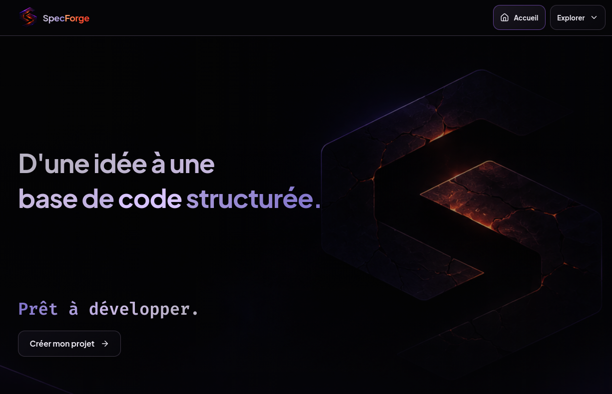

# SpecForge

**Specification → Architecture → Generation**

SpecForge est un outil de conception et de génération de squelettes de projets logiciels.

Son objectif est de transformer une intention structurée en une **architecture cohérente** et en un **squelette de projet exploitable**, sans chercher à générer un produit fini ni à remplacer le développeur.



---

## Principe

```text
Profil technique
        +
Type d'application
        ↓
Template adapté
        ↓
ProjectSpecification
        ↓
        CORE
 ┌─────────────────┐
 │ Validate        │
 │ Resolve         │
 │ Generate        │
 └─────────────────┘
        ↓
Squelette du projet
        ↓
Développeur
```

La **ProjectSpecification** constitue la source de vérité.

Le **Core** constitue l'autorité technique : il valide la Specification, résout les dépendances et génère le résultat.

---

## Philosophie

SpecForge repose sur quelques principes simples :

* **Specification first** — l'intention est formalisée avant la génération.
* **Core first** — la logique technique appartient au Core, pas à l'interface.
* **Déterministe** — une même Specification doit produire un résultat prévisible.
* **Explicable** — les choix et erreurs doivent rester compréhensibles.
* **Modulaire** — les capacités techniques sont représentées par des briques.
* **Progressif** — la complexité n'est ajoutée que lorsqu'elle devient nécessaire.
* **Développeur libre** — le projet généré reste indépendant de SpecForge.

> SpecForge génère une base saine. Le développeur construit le produit.

---

## Interface utilisateur

L’accueil propose un parcours de création progressif, sur une seule page :

1. choisir un profil technique ;
2. choisir un template compatible ;
3. nommer le projet ;
4. générer et télécharger le squelette en ZIP.

Les étapes se dévoilent au fil des choix. Les vues destinées à l’exploration technique — spécification, architecture, fichiers, briques et audit — restent accessibles depuis le menu **Explorer**.

L’interface adopte l’identité **Obsidian Volcanic** : fonds sombres, surfaces translucides, accents violets et touches de rouge incandescent. Les tokens visuels et états interactifs sont définis dans `src/index.css`. Les assets `hero.png` et `hero-mobile.png` adaptent le fond aux écrans desktop et mobiles ; le mouvement de parallaxe est désactivé sur mobile et lorsque la réduction des animations est demandée.

Les sélecteurs personnalisés prennent en charge la navigation au clavier et les titres partagés utilisent une animation de vague avec halo, respectueuse de `prefers-reduced-motion`.

---

## Profils techniques

SpecForge est conçu pour supporter plusieurs profils :

* Rust
* Python
* TypeScript
* Go

**Actuellement, seul le profil Rust est complet** (sept templates). Le profil TypeScript n'a qu'un template (Web Frontend, avec React). Python et Go font partie du modèle cible, mais ne sont pas encore développés.

---

## Types d'applications

Chaque profil peut proposer ses propres templates pour les mêmes grandes catégories d'applications :

| Type             | Description                        |
| ---------------- | ---------------------------------- |
| **Web Frontend** | Application web côté client        |
| **Web App**      | Frontend + backend                 |
| **Web Platform** | Frontend et backend séparés        |
| **API Service**  | Service backend sans interface web |
| **Desktop**      | Application bureau native          |
| **Mobile**       | Application mobile                 |
| **E-commerce**   | Squelette métier spécialisé pour une boutique |

Tous les types sont visibles dans l'interface. Un type peut simplement être indisponible lorsqu'aucun template n'est encore défini pour le profil sélectionné.

---

## Templates

Les templates décrivent des architectures de référence adaptées à un couple :

```text
Profil technique
        +
Type d'application
```

Ils sont actuellement définis dans :

```text
src/engine/presets.ts
```

Templates Rust actuellement disponibles :

* Rust + Askama + SQLite → Web App
* Rust + React + PostgreSQL → Web Platform
* Rust + Askama (frontend seul) → Web Frontend
* Rust Backend Only → API Service
* Rust + Tauri + React → Desktop
* Rust + Dioxus → Mobile
* Rust + Axum + React + PostgreSQL → E-commerce (`rust-ecommerce`)

Les types d'applications génériques sont couverts par un template Rust ; le preset e-commerce est une spécialisation métier distincte.

### Rust E-commerce V2

Le preset `rust-ecommerce` génère un squelette React/Vite, Axum et PostgreSQL/SQLx couvrant notamment le catalogue, les commandes, les comptes, les retours, les pages de contenu, les indicateurs d'administration et les documents opérationnels PDF.

Son interface reprend les principes visuels et les parcours du [prototype UI/UX R&D](docs/ecommerce/UI-UX_template_e-commerce/README.md). Ce prototype reste une référence de conception : ses données fictives ne sont pas reprises comme source fonctionnelle. Les écrans générés consomment les API du projet. Le résultat reste un squelette à adapter et configurer, pas une boutique prête à exploiter.

---

## Core

Le Core est indépendant de l'interface.

```text
src/core/
├── types.ts
├── utils.ts
├── registry.ts
├── validator.ts
├── resolver.ts
├── generator.ts
├── index.ts
└── bricks/
    └── default-bricks.ts
```

### Validator

Vérifie que la Specification est cohérente et que les capacités demandées sont supportées.

### Registry

Contient les briques techniques connues par SpecForge.

Une brique peut déclarer :

* ses capacités ;
* ses dépendances ;
* ses compatibilités ;
* ses conflits ;
* ses fichiers ;
* ses conditions d'activation.

### Resolver

Transforme la Specification en architecture résolue.

### Generator

Produit les fichiers du squelette à partir de l'architecture résolue.

---

## IA

L'IA est une **couche d'assistance**, pas l'autorité technique.

Elle peut notamment :

* aider à formaliser une intention ;
* proposer une Specification ;
* expliquer une architecture ;
* aider à comprendre les choix du système.

Le flux reste :

```text
Intention
    ↓
IA
    ↓
Proposition
    ↓
ProjectSpecification
    ↓
Core
    ↓
Validation / Résolution / Génération
```

L'IA peut proposer.

Le Core décide techniquement.

L'utilisateur valide.

---

## Architecture technique

```text
┌───────────────────────────────┐
│           React UI            │
│  Wizard / Specification /     │
│  Architecture / Files / Audit│
└───────────────┬───────────────┘
                │
                ▼
┌───────────────────────────────┐
│     Node / Express Bridge     │
│                               │
│  API / IA / Vite middleware   │
└───────────────┬───────────────┘
                │
                ▼
┌───────────────────────────────┐
│             Core              │
│                               │
│ Validate → Resolve → Generate  │
└───────────────────────────────┘
```

Le bridge applicatif ne doit pas devenir une seconde implémentation du Core.

---

## Stack actuelle

### Frontend

* React 19
* TypeScript
* Vite
* Tailwind CSS
* Lucide
* Motion

### Application / Bridge

* Node.js
* Express
* Vite middleware

### Core

* TypeScript
* architecture indépendante de React
* YAML pour les besoins de parsing/configuration

---

## Structure principale

```text
SpecForge/
├── docs/
│   ├── FICHE-PRODUIT.md
│   ├── ROADMAP.md
│   ├── ARCHITECTURE-CORE-BRICKS-TEMPLATES.md
│   ├── INVENTORY.md
│   ├── TRACKING.md
│   ├── INFRASTRUCTURE.md
│   ├── MAINTENANCE-EVOLUTION.md
│   └── SpecForge-Templates-référence-V1.md
│
├── src/
│   ├── core/
│   │   ├── bricks/
│   │   ├── generator.ts
│   │   ├── index.ts
│   │   ├── registry.ts
│   │   ├── resolver.ts
│   │   ├── types.ts
│   │   ├── utils.ts
│   │   └── validator.ts
│   │
│   ├── components/
│   ├── engine/
│   │   └── presets.ts
│   └── types/
│
├── server.ts
├── package.json
└── README.md
```

---

## Installation

```bash
npm install
```

## Développement

```bash
npm run dev
```

## Build

```bash
npm run build
```

---

## Documentation

La documentation du projet est volontairement séparée par responsabilité.

* **[FICHE-PRODUIT.md](docs/FICHE-PRODUIT.md)** — vision, périmètre et principes du produit.
* **[ROADMAP.md](docs/ROADMAP.md)** — évolutions prévues et ordre des priorités.
* **[ARCHITECTURE-CORE-BRICKS-TEMPLATES.md](docs/ARCHITECTURE-CORE-BRICKS-TEMPLATES.md)** — architecture du Core, des briques et des templates.
* **[INVENTORY.md](docs/INVENTORY.md)** — inventaire fonctionnel des briques.
* **[TRACKING.md](docs/TRACKING.md)** — suivi d'avancement.
* **[INFRASTRUCTURE.md](docs/INFRASTRUCTURE.md)** — architecture technique.
* **[MAINTENANCE-EVOLUTION.md](docs/MAINTENANCE-EVOLUTION.md)** — règles de maintenance et d'évolution.
* **[SpecForge-Templates-référence-V1.md](docs/SpecForge-Templates-référence-V1.md)** — templates et architectures de référence.
* **[ADR e-commerce](docs/ecommerce/ADR-TEMPLATE-ECOMMERCE.md)** — décisions d'architecture, de périmètre et d'intégration.
* **[Modèle de domaine e-commerce V2](docs/ecommerce/MODELE-DOMAINE-V2.md)** — contrats des contenus, métriques, permissions et documents.
* **[Prototype UI/UX R&D](docs/ecommerce/UI-UX_template_e-commerce/README.md)** — périmètre et décisions du prototype statique.

---

## État actuel

SpecForge est actuellement un **prototype fonctionnel en évolution**.

Le socle suivant est en place :

* Core indépendant de l'interface ;
* validation des Specifications ;
* résolution d'architecture ;
* génération déterministe ;
* Registry de briques ;
* système de profils techniques ;
* système de templates par profil et type d'application ;
* sept presets Rust : Web App, Web Platform, Web Frontend, API Service, Desktop, Mobile et E-commerce V2 ;
* génération Desktop (Tauri) et Mobile (Dioxus) ;
* interface de vérification et d'audit ;
* assistance IA séparée du Core.

Le preset e-commerce illustre une spécialisation métier complète au-dessus des briques du Core. La configuration globale d'interface et de thème, partagée entre tous les templates, reste une évolution distincte.

---

## Direction future

Une configuration complémentaire, indépendante des choix propres aux presets spécialisés, permettra progressivement de préciser certains aspects globaux du projet, notamment :

```text
Projet
  ↓
Interface
  ├── Navigation
  ├── Hubs
  └── Sous-hubs
  ↓
Thème
  ├── Mode
  ├── Style
  ├── Couleur principale
  └── Couleur accent
```

Cette configuration restera volontairement simple.

Elle servira à enrichir la **ProjectSpecification** avant son passage dans le Core.

---

## Principe de développement

SpecForge évolue de manière incrémentale :

```text
Besoin
  ↓
Investigation ciblée
  ↓
Modification minimale
  ↓
Build / Vérification
  ↓
Validation
  ↓
Checkpoint
```

La priorité est de conserver une architecture :

**simple, déterministe, lisible, modulaire et évolutive.**

La complexité n'est introduite que lorsqu'un besoin réel la justifie.
