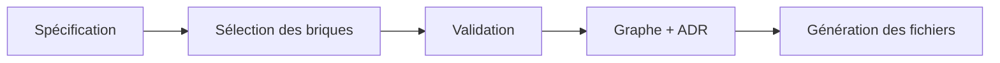

# Guide développeur

Ce guide explique comment SpecForge transforme une spécification en projet généré, et où intervenir pour ajouter un profil. Pour le détail du contrat d'une brique, voir `ARCHITECTURE-CORE-BRICKS-TEMPLATES.md`.

> Sections 5 à 7 (recette « ajouter un profil », preuves, pièges connus) : à écrire après le premier profil réel, pour qu'elles décrivent ce qui a été fait et non ce qui est supposé.

## 1. Vue d'ensemble

Tout part d'une **spécification** (`ProjectSpecification`) : un objet JSON décrivant le projet (profil, template, backend, frontend, base de données, infrastructure…). Le moteur en tire un projet généré en quatre temps.



1. **Sélection** (`select.ts`) : chaque brique déclare dans quels cas elle s'applique. Le moteur garde celles qui correspondent à la spécification.
2. **Validation** (`validator.ts`) : dépendances, conflits et règles de configuration. Une erreur invalide l'architecture et bloque l'export.
3. **Graphe et ADR** (`resolver.ts`) : un nœud par brique active, des arêtes déclarées par les briques, et les décisions d'architecture que chaque brique introduit.
4. **Génération** (`generator.ts`) : chaque brique active produit ses fichiers.

Le point d'entrée est `resolveArchitecture(spec, registry)`. Il renvoie les briques actives, les issues, les nœuds, les arêtes et les ADR.

**Principe directeur : le moteur ne connaît ni Rust, ni Python, ni TypeScript.** Ce qui est propre à un langage vit dans les briques (données et générateurs), pas dans le moteur. Ajouter un profil doit idéalement se limiter à ajouter des briques et des presets.

## 2. Vocabulaire

| Terme | En une phrase |
|---|---|
| **Profil** | L'écosystème technique du projet (`rust`, `python`, `typescript`, `go`). |
| **Template** | Le type d'application (`web-frontend`, `web-app`, `web-platform`, `api-service`, `desktop`, `mobile`). |
| **Preset** | Une spécification complète et cohérente pour un couple profil + template. |
| **Brique** | Une unité déclarative : quand elle s'applique, ce qu'elle fournit, comment elle se relie, quels fichiers elle génère. |
| **Registre** | Le catalogue des briques (`BrickRegistry`). `defaultRegistry` est celui de l'application. |
| **Core** (`src/core`) | Le moteur : types, registre, sélection, validation, résolution, génération. Sans React. |
| **Engine** (`src/engine`) | Les presets et leur recherche (`findPreset`). |
| **ADR** | Une décision d'architecture, produite par la brique qui l'introduit. |

## 3. Carte du dépôt

```text
src/core/
  types.ts          Types : ProjectSpecification, BrickDefinition, issues, résultats
  match.ts          SpecPattern et matchesSpec (le « applies » des briques)
  select.ts         Sélection des briques actives à partir des données
  registry.ts       BrickRegistry et defaultRegistry
  validator.ts      Dépendances, conflits, règles de configuration
  resolver.ts       Orchestration : sélection, validation, ADR, nœuds, arêtes
  generator.ts      Génération des fichiers du projet
  spec-edit.ts      Modifications pures de la spécification (utilisées par le wizard)
  utils.ts          Hash déterministe, tailles
  bricks/           Une brique par fichier, assemblées dans default-bricks.ts
src/engine/presets/ Un preset par fichier, assemblés dans index.ts (PRESETS, findPreset)
src/components/     Interface React (wizard, graphe, visionneuse de briques…)
scripts/            Filets de non-régression (check-*.ts) et golden du graphe
```

`src/types/spec.ts` ré-exporte simplement `core/types`.

## 4. Comment une brique est choisie, reliée et validée

Une brique est un objet `BrickDefinition`. Les exemples viennent de `rust-backend`.

### Sélection : `applies` et `subsumes`

```ts
applies: [{ backend: { enabled: true, language: 'rust' } }],
```

`applies` est une liste de motifs en OU. Les clés d'un même motif sont en ET : ici, le backend doit être activé **et** en Rust. Sans `applies`, une brique n'est jamais sélectionnée automatiquement.

`subsumes` liste des catégories que la brique prend entièrement en charge. Quand `rust-web-app` est active, elle remplace `rust-backend` : cette dernière n'apparaît pas dans les briques actives.

### Dépendances et conflits : `provides`, `requires`, `conflictsWith`

- `provides` : capacités apportées (`backend_runtime`…).
- `requires` : capacités nécessaires. Une capacité absente produit une erreur de validation.
- `conflictsWith` : ids de briques incompatibles avec celle-ci.

### Arêtes du graphe : `links`

Les arêtes sont déclarées **sur la brique cible**. Chaque entrée produit au plus une arête, depuis la **première** source active de sa liste `from` (un id de brique, ou `{ category }` pour la première brique de cette catégorie).

```ts
links: [{ from: [{ category: 'backend' }], label: 'Connection Pool', protocol: 'Direct File I/O' }]
```

C'est la forme de `sqlite-storage` : « la base reçoit une arête depuis le backend actif ». Une liste `from` ordonnée sert à exprimer une priorité (backend avant `react-vite` pour `docker-infra`, par exemple).

### Couche du nœud : `layer`

```ts
layer: 'app',
```

Obligatoire. Valeurs : `client`, `gateway`, `app`, `data`, `ops`. Elle ne se déduit plus de la catégorie : `rust-web-app` est en catégorie `frontend` mais en couche `app`.

### Frameworks supportés : `backendStack`

```ts
backendStack: { language: 'rust', frameworks: ['axum'] },
```

Une brique de backend déclare les frameworks qu'elle supporte pour un langage. Deux consommateurs :

- le **validateur** signale `unsupported-framework-<langage>-<framework>` quand la spécification choisit un framework non déclaré. Il cherche la brique dans le **registre**, pas dans les briques actives : l'erreur doit rester visible même quand la brique est absorbée par une autre ;
- le **wizard** construit ses listes de langages et de frameworks depuis ces déclarations. Seuls les libellés longs restent dans des tables locales de `ProjectWizard.tsx`.

### Fichiers et décisions : `generateFiles`, `generateDecisions`

Ces fonctions reçoivent le contexte de génération (dont la spécification) et renvoient les fichiers ou les ADR de la brique. Une brique peut adapter sa sortie à la spécification, par exemple générer un code différent selon le langage du backend.

### Ordre du registre

L'ordre des briques dans `default-bricks.ts` n'est pas neutre : il détermine l'ordre des briques actives, donc celui des nœuds, des ADR et des fichiers générés. Une nouvelle brique s'y insère à une position à justifier, et le test `_brick-order` de `check-golden` le surveille.